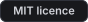
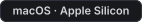
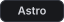
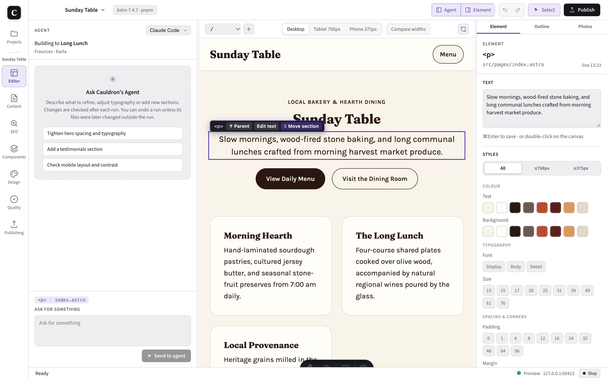
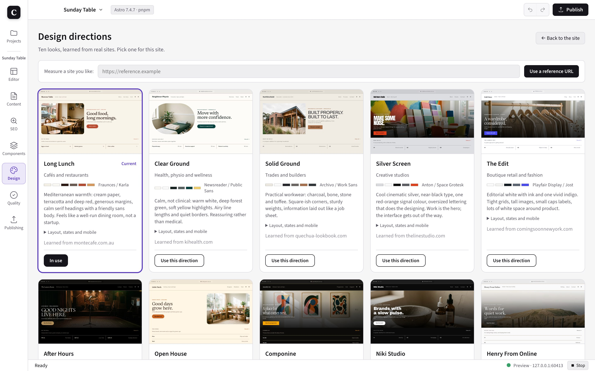
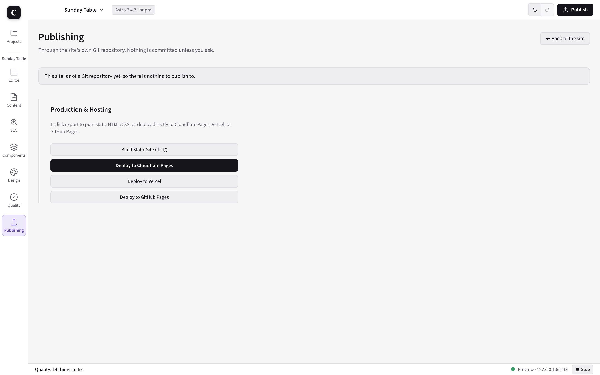
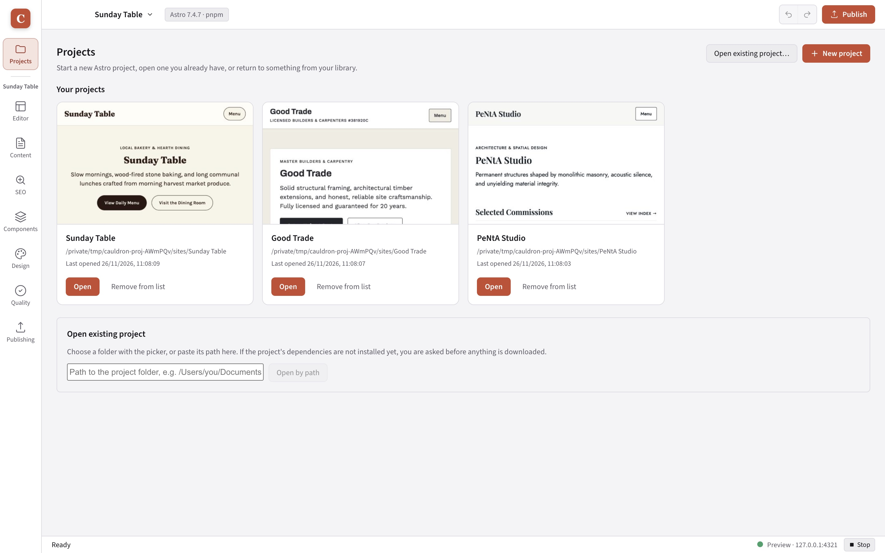
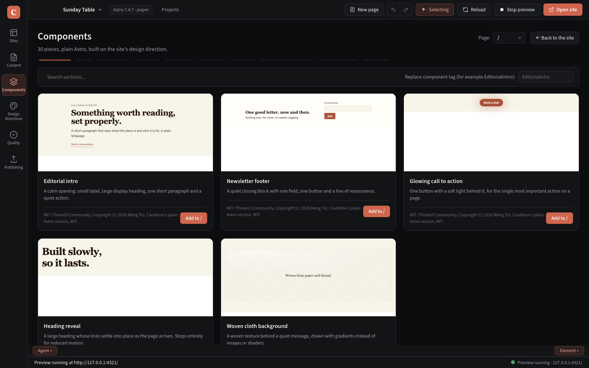
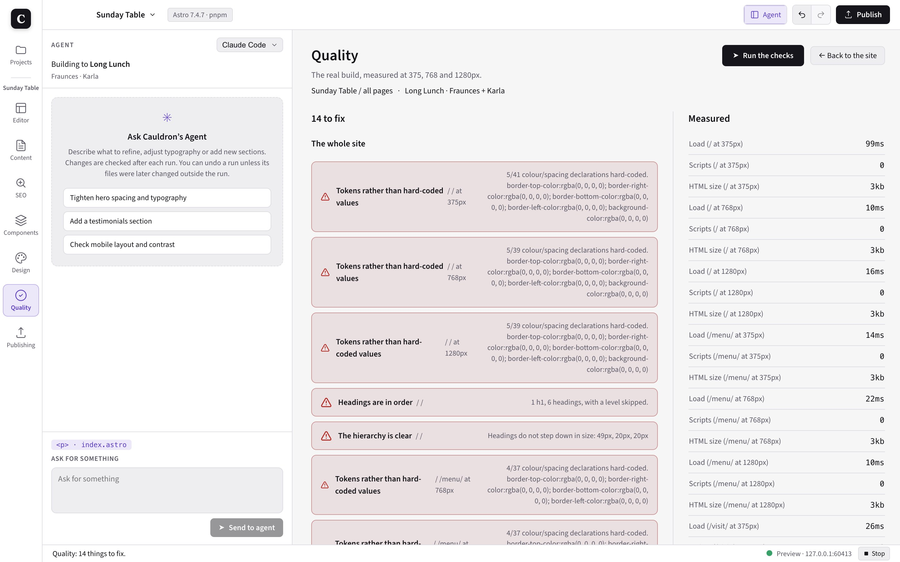

<p align="center">
  <picture>
    <source media="(prefers-color-scheme: dark)" srcset=".github/readme/logo-dark.svg">
    
  </picture>
</p>

<p align="center">Free visual builder for Astro websites, with design taste built in. Mac app.</p>

<p align="center">
  <a href="https://github.com/cre8tivoz/cauldron/releases/latest"></a>
  <a href="https://github.com/cre8tivoz/cauldron/releases"></a>
</p>

<p align="center">
  <a href="LICENSE"></a>
  
  <a href="https://astro.build"></a>
</p>

<p align="center">
  
</p>

Cauldron opens or creates an [Astro](https://astro.build) site folder on your Mac and shows the real site live alongside an AI agent and visual inspector. Edit by hand or ask your agent to build; everything is saved as ordinary Astro files in your own folder, with no lock-in.

## Build with agents

Drive **Claude Code**, **Codex**, or **Hermes** directly from the built-in Agent panel using the CLIs already installed on your Mac. Agents receive your site's active design direction and tokens, work through Cauldron's checked actions, and every run comes with live progress and per-run undo.

No agent installed? Choose **Your AI key** in the Agent panel and paste a key from **OpenRouter**, **Anthropic** or **OpenAI**, or point it at a model running locally in **Ollama**. The chat then runs inside Cauldron with the same checked actions and undo. Your key is encrypted by your Mac's keychain and is only ever sent to the provider you chose.

## Design taste built in

Pick from **10 curated design directions** (including Long Lunch, Clear Ground, Solid Ground, Silver Screen, Componine, Niki Studio, and Henry From Online) or measure a reference URL to generate tokens for colour, typography, spacing, and radii. Preview your site at **Desktop**, **Tablet (768px)**, and **Phone (375px)** widths — one at a time, or all three side by side with **Compare widths**, each rendered at its real width so the layout reacts exactly as it will on a phone.

<p align="center">
  
</p>

## Publish or export

Commit and push through the site's own Git repository, deploy in one click to **Cloudflare Pages**, **Vercel**, or **GitHub Pages**, or export a pure static `dist/` build.

<p align="center">
  
</p>

## Also included

<table>
  <tr>
    <td width="50%"><br><b>Projects &amp; starters.</b> Five ready-to-go Astro starters and project cards with live snapshots.</td>
    <td width="50%"><br><b>Section library.</b> A plain-Astro, tokenised library across seven categories, with live previews and search.</td>
  </tr>
  <tr>
    <td><br><b>Quality &amp; accessibility.</b> Real build checks across 375px, 768px, and 1280px widths, with agent follow-up.</td>
    <td><br><b>Local files, zero lock-in.</b> Plain Astro files on your Mac, buildable anywhere without Cauldron.</td>
  </tr>
</table>

## Download (unsigned Mac build)

Download **`Cauldron-darwin-arm64-0.10.0.zip`** from [GitHub Releases](https://github.com/cre8tivoz/cauldron/releases), or build it locally from source (`Node.js` 26.13, `npm` 12):

```bash
npm install
npm run make   # produces out/make/zip/darwin/arm64/Cauldron-darwin-arm64-0.10.0.zip
```

> **Unsigned macOS app — first launch:**
> Cauldron is distributed **unsigned and not notarised** (no Apple Developer certificate). On first launch, macOS Gatekeeper may block `Cauldron.app`:
>
> 1. Unzip `Cauldron-darwin-arm64-0.10.0.zip` and move **`Cauldron.app`** into **Applications**.
> 2. Try opening **`Cauldron.app`**. If macOS says the developer cannot be verified, dismiss the dialog.
> 3. Open **System Settings → Privacy & Security**, scroll down to the Cauldron notice, click **Open Anyway**, and confirm **Open**.
>
> _(Note: CI and local builds package and launch the `.app` cleanly, though opening a downloaded copy by hand on a separate Mac has not been manually tested yet.)_

## Development

Requires **Node.js 26.13** (`.nvmrc`) and **npm 12** (`pnpm` is optional and used automatically for shared site dependencies when installed).

```bash
git clone https://github.com/cre8tivoz/cauldron.git
cd cauldron
npm install
npm start
```

Checks:

```bash
npm run check       # type check, lint, formatting, and unit tests
npm run smoke       # package the app, open it hidden, confirm it renders
npm run verify:mac  # run check + local Mac smoke verification
```

| Folder            | Contents                                                                                        |
| ----------------- | ----------------------------------------------------------------------------------------------- |
| `src/main/`       | Electron main process: Astro dev server, preview host, MCP actions, agents, quality, publishing |
| `src/components/` | React editor interface (Agent panel, Inspector, Projects, Library, Design, Quality, Publishing) |
| `scripts/`        | Unit test suites (`test-core`, `test-agent`, `test-gemini-upgrades`) and smoke checks           |
| `docs/adr/`       | Architecture Decision Records explaining why Cauldron is built the way it is                    |

Want to tinker or send a pull request? See [CONTRIBUTING.md](CONTRIBUTING.md).

## Privacy

Your sites, recents list, run history, and preview thumbnails stay on your Mac. Cauldron has **no telemetry, no analytics, and no tracking**.

The app only goes online when you ask it to:

- load Google Fonts in site previews or the Design directions view;
- download npm/pnpm packages when you create or prepare an Astro project;
- send your requests to the AI provider you chose, with your own key, when you use **Your AI key**;
- run your installed CLI agents (`claude`, `codex`, `hermes`) or deploy to a host you choose (Git, Cloudflare Pages, Vercel, or GitHub Pages) using your own local credentials.

## Licence

MIT. See [LICENSE](LICENSE).
